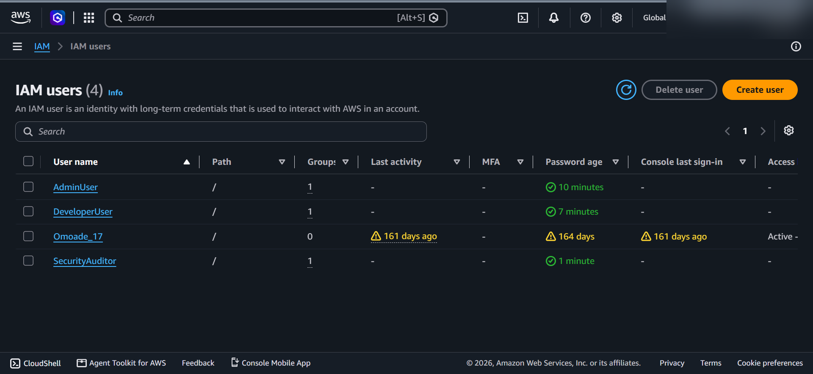
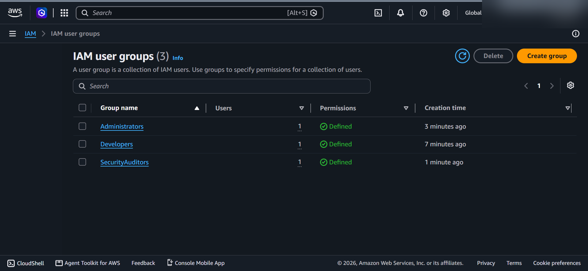
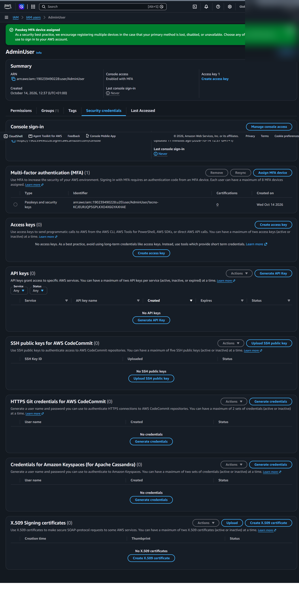
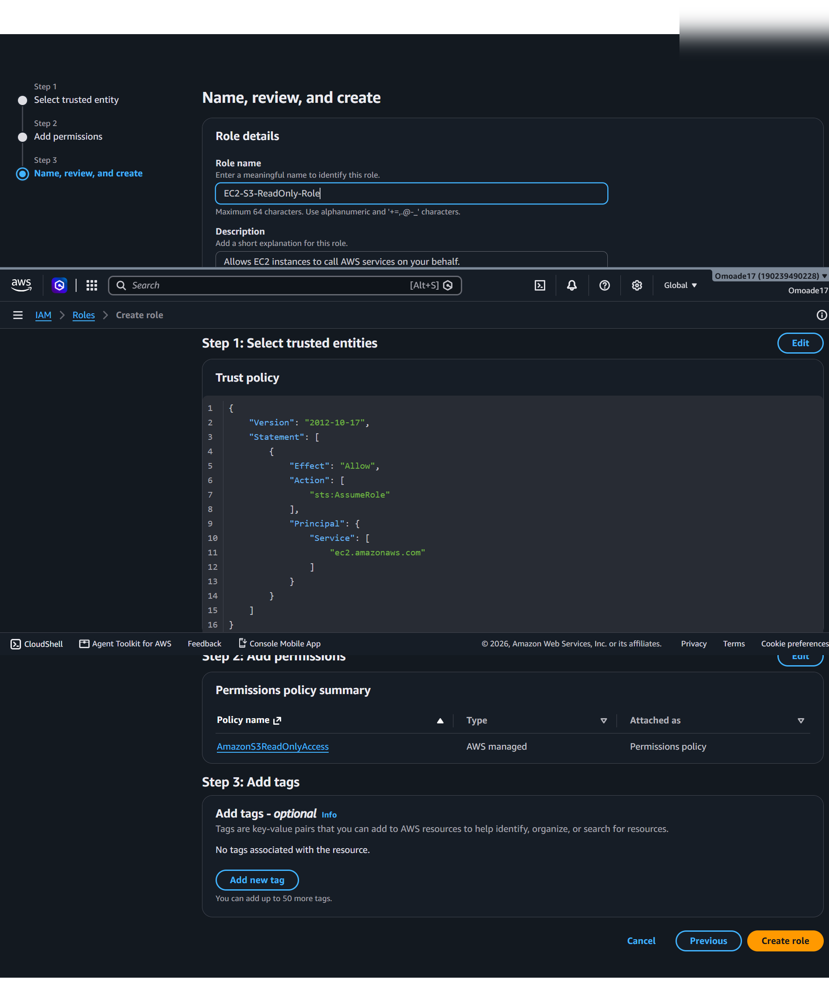
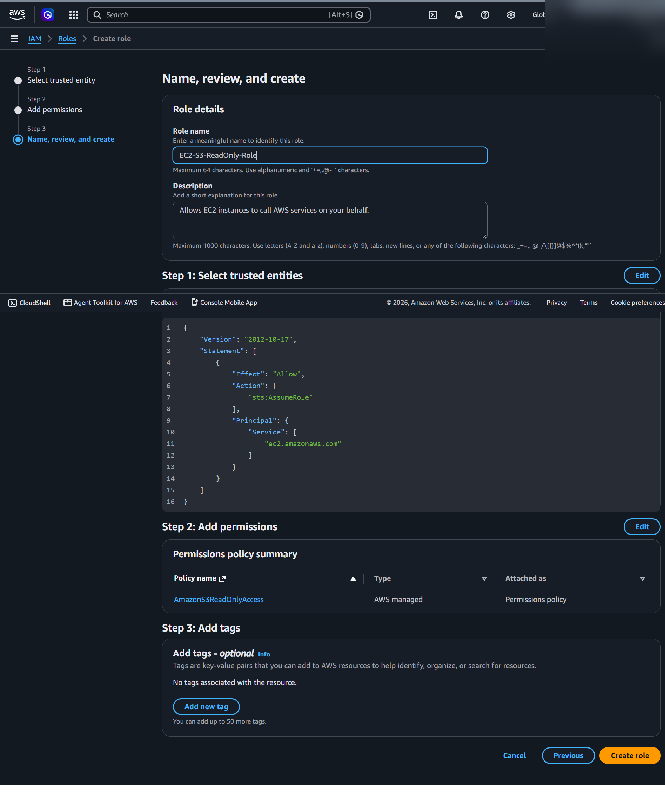
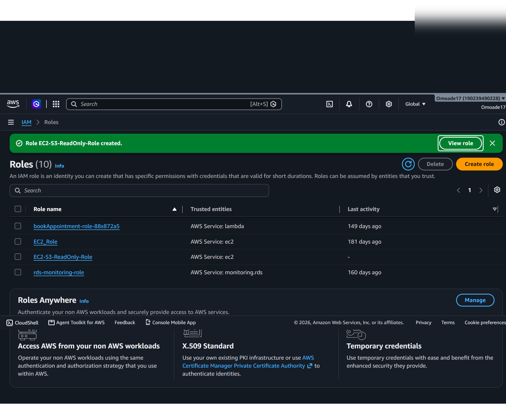
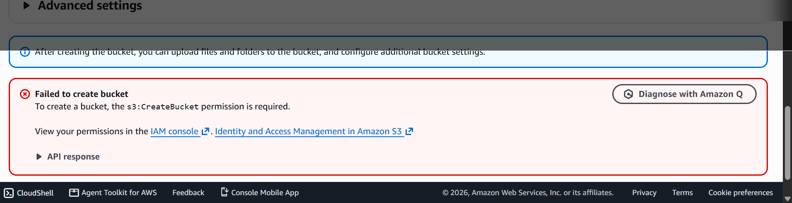
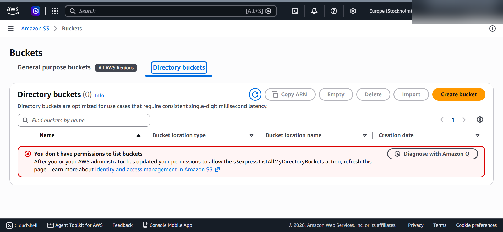

# AWS IAM Security Lab 🔐

A hands-on identity and access management project exploring IAM users, groups, an EC2 service role, and access-denied behavior in Amazon S3.

## Project status

**Completed (documented steps).** Screenshots show the user/group setup, EC2 role creation, and S3 access-denied messages. MFA configuration and IAM Policy Simulator results are **not evidenced** in the supplied screenshots.

## Objectives

- Organize IAM users into responsibility-based groups.
- Explore permission assignment and least-privilege access.
- Create an IAM role trusted by EC2 with S3 read-only permissions.
- Observe how AWS denies operations when permissions are insufficient.

## Tools

AWS Management Console · AWS IAM · Amazon EC2 IAM role configuration · Amazon S3

## Implementation and evidence

### 1. IAM identities and groups

The IAM console shows three lab users (`AdminUser`, `DeveloperUser`, `SecurityAuditor`) alongside an existing account user. It also shows three groups (`Administrators`, `Developers`, `SecurityAuditors`), each with one member. The screenshots do not establish every attached group policy, so those are not asserted here.

### 2. IAM user configuration

Reviewed an IAM user's configuration and access details in the console.

### 3. EC2 service role

Used the IAM role creation workflow to configure an EC2-trusted role with the AWS-managed `AmazonS3ReadOnlyAccess` policy. The role creation confirmation is visible in the console. This lab did not demonstrate launching an EC2 instance or attaching the role to a running instance.

### 4. Access-control observations in S3

The S3 console displayed permission errors while signed in as the developer lab identity:

- Attempting to create a bucket was denied because `s3:CreateBucket` permission was required.
- The Directory buckets view reported insufficient permission to list buckets. This screenshot concerns **directory buckets**, not proof that general-purpose bucket listing was denied.

These observations illustrate how permissions affect AWS console actions; they are not a substitute for a full IAM Policy Simulator test.

## Key takeaways

- IAM groups help organize permissions around responsibilities.
- Service roles allow AWS services to receive scoped permissions without embedding static access keys.
- Read-only access does not authorize resource creation.
- An access-denied message identifies a missing permission and helps validate an access-control design.

## Author

Yusuf Tajudeen — Cybersecurity student | AWS Certified Cloud Practitioner
